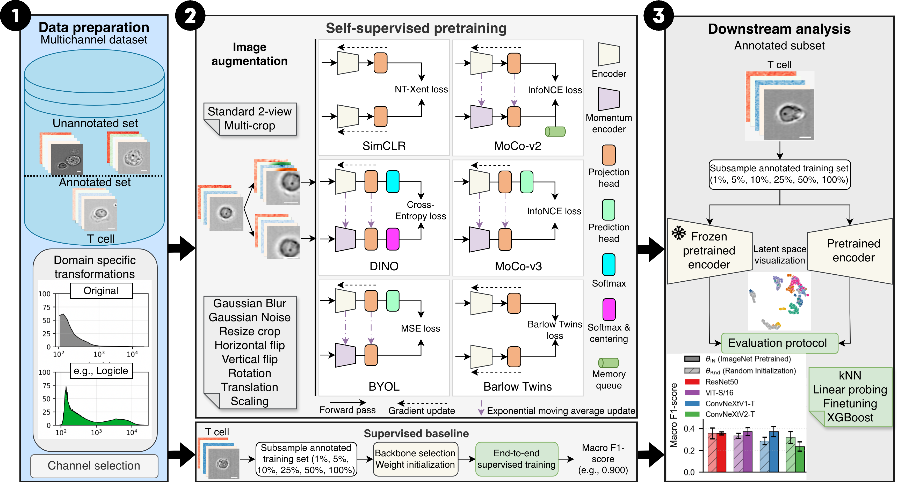

# IFC-SSL-Bench

A benchmark of self-supervised learning for high-throughput imaging flow cytometry.

<p align="center">
  
</p>

<p align="center">
  <em>Self-supervised pretraining on unlabelled imaging flow cytometry data,
  followed by evaluation across annotation regimes with frozen-feature and
  fine-tuning protocols.</em>
</p>

This repository contains the code and configurations for a systematic evaluation of seven
self-supervised objectives across four backbones, with or without ImageNet-supervised weight
initialisation, on two imaging flow cytometry datasets and a range of annotation regimes.
Preprocessing and pretraining scale are held fixed so that comparisons isolate the objective
and the initialisation.

---

## Contents

- [Overview](#overview)
- [Installation](#installation)
- [Quick start](#quick-start)
- [Datasets](#datasets)
- [Preprocessing](#preprocessing)
- [Splits and annotation subsets](#splits-and-annotation-subsets)
- [Running experiments](#running-experiments)
- [Configuration](#configuration)
- [Outputs](#outputs)
- [Reproducing the published results](#reproducing-the-published-results)
- [Citation](#citation)
- [License](#license)

---

## Overview

The pipeline runs in two stages.

**Stage 1 — Pretraining.** A backbone is trained on unannotated images with one of the
self-supervised objectives, or supervised from labels as a baseline.

**Stage 2 — Benchmarking.** The resulting representation is evaluated with five protocols
across several annotation fractions.

| | |
|---|---|
| **Objectives** | Supervised · SimCLR · MoCo v2 · MoCo v3 · BYOL · Barlow Twins · VICReg · DINO |
| **Backbones** | ResNet-50 · ConvNeXt-T · ConvNeXt V2-T · ViT-S/16 |
| **Initialisation** | random · ImageNet-supervised weights |
| **Datasets** | RBC morphology · Immunological synapses (ISF-5CH) · BloodMNIST (pipeline check) |
| **Evaluation** | *k*-NN · Linear probe · XGBoost · Fine-tuning |
| **Annotation fractions** | 1 · 5 · 10 · 25 · 50 · 100 % |
| **Seeds** | 3 per configuration |

### Evaluation protocols

All five operate on the same frozen embeddings except fine-tuning, which updates the backbone.

| Protocol | Features | What it measures |
|---|---|---|
| *k*-NN | frozen, L2-normalised | local separability; `k` reported per run |
| Linear probe | frozen, z-scored | linear separability |
| XGBoost | frozen, z-scored | non-linear separability of the frozen features |
| Fine-tuning | backbone updated | end-task performance with the representation as initialisation |

Metrics written for every protocol: accuracy, accuracy per-class, macro F1, per-class F1.

---

## Installation

Requires Python 3.12.9 and a CUDA-capable GPU for pretraining. Evaluation and figure
generation run on CPU.

```bash
git clone <REPO_URL>
cd IFC-SSL-Bench

python3.12 -m venv .venv
source .venv/bin/activate
pip install --upgrade pip
pip install -r requirements.txt
```

### Experiment tracking (optional)

Weights & Biases is supported but not required:

```bash
wandb login
export WANDB_PROJECT=ifc-ssl-bench
```

Set `WANDB_MODE=disabled` to turn it off. All metrics are also written locally under `logs/`,
so nothing depends on having an account.

---

## Quick start

BloodMNIST downloads itself, so this runs end to end with no manual data setup and checks that
pretraining, evaluation and logging all work:

```bash
DATASET=BloodMNIST MODEL=SimCLR BACKBONE=ResNet50 \
INIT_TYPE=imagenet_weights SEED=0 python run.py
```

Set `test: {max_epochs: 2}` in `config.yml` and `test_run=True` in `run.py` for a two-epoch
smoke test. Expect results under `logs/benchmark/BloodMNIST/0/ResNet50/imagenet_weights/`.

---

## Datasets

| Dataset | Role | Access | Reference |
|---|---|---|---|
| RBC morphology | Benchmark | figshare, see below | Doan et al., *PNAS* **117**, 21381–21390 (2020) |
| Immunological synapses (ISF-5CH) | Benchmark | [Dryad](https://datadryad.org/dataset/doi:10.5061/dryad.ht76hdrk7) | Shetab Boushehri et al., *Nat. Commun.* **14**, 7888 (2023) |
| BloodMNIST | Pipeline check | [`medmnist`](https://github.com/MedMNIST/MedMNIST) library | Acevedo et al., *Data in Brief* **30**, 105474 (2020) |

**BloodMNIST is used only to validate the pipeline**, not as a benchmark dataset. It is small,
public and fast to run. It is obtained through the MedMNIST library (`pip install medmnist`),
so no manual download is needed.

The code does not download or reorganise data. You build the directory layout once, fetch the
metadata tables from the [Zenodo deposit](TODO-DOI), and point `config.yml` at them.

```text
DATA_ROOT/
  RBC_Dataset/
    labeled_set/
      Training_Canada_Swiss/CLASS/*.ome.tif
      Test3_HoldOut_Canada_Swiss/CLASS/*.ome.tif
      Test1_Consensus_groundtruth/CLASS/*.ome.tif
    unlabeled/                 # extracted .h5
    rbc_metadata.csv           # from the Zenodo deposit
  Immuno_Synapses/
    data/                      # extracted .h5
    isf_metadata.csv           # from the Zenodo deposit
```

### 1. RBC morphology

**Labelled subset.** Download from [figshare](https://doi.org/10.6084/m9.figshare.12432506)
and extract into `RBC_Dataset/labeled_set/`, keeping the directory names of the original
release. These are not random partitions: they differ in acquisition site and annotation
protocol, and we use them as released (see [Splits](#splits-and-annotation-subsets)).

**Unlabelled subset.** Download from [figshare](https://doi.org/10.6084/m9.figshare.12432959)
and extract into `RBC_Dataset/unlabeled/`, keeping the original directory tree. The release
ships `.cif` archives, which must be extracted first:

```bash
python utils/cif_daf_file_extraction.py          # extract_from_CIF(cif_path, images_target_dir)
```

This requires [python-bioformats](https://pypi.org/project/python-bioformats/) and
[python-javabridge](https://pypi.org/project/python-javabridge/).

**Metadata** (`rbc_metadata.csv`, from the Zenodo deposit), one row per image:

| column | meaning |
|---|---|
| `File Path` | path to the image, relative to `RBC_Dataset/` |
| `CE` | blood-bag identifier (e.g. `CE44`), as defined in Doan et al. |
| `Day` | storage day, integer |

### 2. Immunological synapses (ISF-5CH)

Download the `.h5` files from [Dryad](https://datadryad.org/dataset/doi:10.5061/dryad.ht76hdrk7)
and extract into `Immuno_Synapses/data/`.

**Metadata** (`isf_metadata.csv`, from the Zenodo deposit), one row per image:

| column | meaning |
|---|---|
| `Path` | path to the `.h5` file, relative to `Immuno_Synapses/` |
| `State` | `labeled` or `unlabeled` |
| `Label` | annotated class name; empty for unlabelled rows |
| `Experiment` | acquisition identifier (I–IV in the source paper) |
| `Donor` | donor identifier |
| `Antibody_or_Condition` | treatment arm |

`State` is the field that partitions the acquisition: pretraining loads only `unlabeled` rows
and evaluation only `labeled` rows, so the two subsets are disjoint by construction. No image
path occurs under both states. `Experiment` and `Donor` are used for the analysis of
experiment-level structure.

### Pointing the configuration at the data

There is no setup script. Set the paths in `config.yml`:

```yaml
RBC_Dataset:
    data_dir: "<DATA_ROOT>/RBC_Dataset"
    csv_path: "<DATA_ROOT>/RBC_Dataset/rbc_metadata.csv"

Immuno_Synapses:
    data_dir: "<DATA_ROOT>/Immuno_Synapses"
    csv_path: "<DATA_ROOT>/Immuno_Synapses/isf_metadata.csv"
```

---

## Preprocessing

**RBC canvas matching.** The annotated RBC images are released at a fixed 48 × 48 pixels,
produced by Doan et al. with cropping or padding rather than interpolation. The unannotated
release keeps each event's native bounding-box dimensions. To give both subsets the same field
of view and the same pixel scale, apply the identical operation to the unannotated images
before training:

```bash
python data_preprocessing/rbc_preprocess.py --csv <DATA_ROOT>/RBC_Dataset/rbc_metadata.csv \
       --fill 791.6,49.4,790.6,72.0 --workers 6
```

Images are centre-cropped or centre-padded in place; `--fill` sets the per-channel padding
value (the dataset channel means).

**Resampling.** All images are then resampled to 224 × 224 by bilinear interpolation with
antialiasing, matching the resolution at which the backbones were pretrained. The target is
square, so the original aspect ratio is not preserved.

**Normalisation.** Per-channel z-scoring using the statistics in `config.yml`, computed
separately for each dataset and subset.

---

## Splits and annotation subsets

**RBC.** We use the partition released with the original data and do not define our own:
`Training_Canada_Swiss` for training, `Test3_HoldOut_Canada_Swiss` for validation and
`Test1_Consensus_groundtruth` for testing.

**ISF-5CH.** No canonical partition exists, so one is generated: a stratified 64 / 16 / 20 %
split of the annotated set, drawn once with a fixed seed (`SPLIT_SEED = 0` in
`data_processing/data_loader.py`).

**Annotation subsets.** At each fraction, a stratified subset of the training split is drawn
per class. Nesting is guaranteed by construction: for a given seed each class is permuted once
and a fraction takes a prefix of that fixed ordering, so the subset at any fraction is a strict
subset of every larger one. Where a class's share rounds below one image, one image is kept.
The validation split is subsampled at the same fraction by the same procedure, so the reported
fraction corresponds to the total number of labels consumed.

**Released image lists.** Every partition and every annotation subset is released as a manifest
in the [Zenodo deposit](TODO-DOI), and regenerated locally on each run under:

```text
logs/splits/<dataset>/split_seed0.csv                       index, split, label, sample_id
logs/subsets/<dataset>/<seed>/<fraction>%/train.csv         index, label, sample_id
logs/subsets/<dataset>/<seed>/<fraction>%/val.csv
```

**To reproduce the labelled-fraction results exactly, use the image lists per labelled subset
in the Zenodo deposit** rather than regenerating them — they identify each image by path, so
they are independent of local filesystem ordering.

---

## Running experiments

A run is specified entirely by environment variables:

```bash
DATASET=Immuno_Synapses \
MODEL=SimCLR \
BACKBONE=ResNet50 \
INIT_TYPE=imagenet_weights \
SEED=0 \
python run.py
```

| Variable | Accepted values |
|---|---|
| `DATASET` | `RBC_Dataset` · `Immuno_Synapses` · `BloodMNIST` |
| `MODEL` | `Supervised` · `SimCLR` · `MoCoV2` · `MoCoV3` · `BYOL` · `BarlowTwins` · `VICReg` · `DINO` |
| `BACKBONE` | `ResNet50` · `ConvNeXt` · `ConvNeXtV2` · `ViTBackbone` |
| `INIT_TYPE` | `imagenet_weights` · `random` |
| `SEED` | integer; |
| `EPOCH` | optional; resume pretraining from this epoch |

`run.py` runs pretraining and then benchmarking across all annotation fractions
(`subset_fractions` in `run.py`: 1, 5, 10, 25, 50, 100). `run_local.py` is the same
pipeline with a smaller default configuration for a single machine.

To enumerate every configuration in the paper:

```bash
python scripts/make_combos.py > combos.txt      # one line of variables per run
```


---

## Configuration

`config.yml` holds all experiment parameters: epochs, batch size, embedding dimension,
per-objective learning rates and weight decay, per-dataset channel selection and normalisation
statistics, and the augmentation parameters. Learning rates are given as `[batchnorm,
layernorm]` pairs, selected automatically from the backbone's normalisation type.

---

## Outputs

Each run writes, under `logs/`:

| Path | Contents |
|---|---|
| `checkpoints/…` | last, best and periodic weights |
| `losses/<dataset>/<seed>/<backbone>/<init>/<fraction>%/` | per-epoch training loss, CSV and figure |
| `benchmark/<dataset>/<seed>/<backbone>/<init>/<fraction>%/` | metrics CSV, confusion matrices, ROC, UMAP, PCA |
| `splits/`, `subsets/` | the image lists described above |

The metrics CSV carries one row per protocol with accuracy, macro F1, per-class F1 and AUROC,
alongside the full run metadata.

---

## Reproducing the published results

1. Download both datasets and place them as shown under [Datasets](#datasets).
2. Fetch the metadata tables and the split and subset manifests from the
   [Zenodo deposit](TODO-DOI).
3. Apply the RBC canvas matching (see [Preprocessing](#preprocessing)).
4. Either run the full grid with `scripts/make_combos.py`, or download the pretrained weights
   from the Zenodo deposit and run benchmarking only.
5. For the labelled-fraction results, use the released subset manifests rather than
   regenerating them locally.

---

## Citation

```bibtex
@misc{sitcheu2026ifcsslbench,
      title={IFC-SSL-Bench: Benchmarking Self-Supervised Learning for Annotation-Efficient Multispectral Imaging Flow Cytometry},
      author={Angelo Jovin Yamachui Sitcheu and Roxana-Teodora Fetescu and Thomas Lautenschlager and Nils Friederich and Linus Schilpp and Stephan Allgeier and Luca Deininger and Daniel Hübschmann and Ralf Mikut},
      year={2026},
      eprint={2610.31848},
      archivePrefix={arXiv},
      primaryClass={cs.CV},
      url={https://arxiv.org/abs/2610.31848},
}
```

## License

Released under the MIT License. See [LICENSE](LICENSE).
