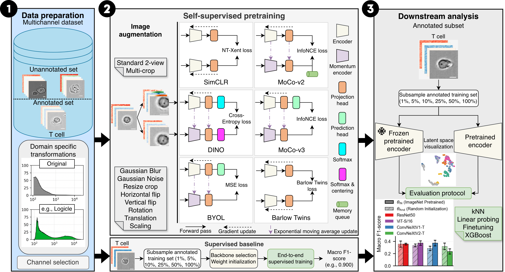

# IFC-SSL-Bench

A benchmark of self-supervised learning for high-throughput imaging flow cytometry.

<p align="center">
  
</p>

<p align="center">
  <em>Self-supervised pretraining on unlabelled imaging flow cytometry data,
  followed by evaluation across annotation regimes with frozen-feature and
  fine-tuning protocols.</em>
</p>

This repository contains the code and configurations for a systematic evaluation of six
self-supervised objectives across four backbones with our without ImageNet-supervised weights initalization, on two diverse imaging
flow cytometry datasets and a range of annotation regimes, with preprocessing and pretraining
scale held fixed so that comparisons isolate the objective and the initialization.

---

## Contents

- [Overview](#overview)
- [Installation](#installation)
- [Quick start](#quick-start)
- [Datasets](#datasets)
- [Running experiments](#running-experiments)
- [Configuration](#configuration)
- [Outputs](#outputs)
- [License](#license)

---

## Overview

The pipeline runs in two stages.

**Stage 1 — Pretraining.** A backbone is trained on unannotated images with one of
the self-supervised objectives, or supervised as a baseline.

**Stage 2 — Benchmarking.** The resulting representation is evaluated with three protocols (
*k*-NN classification, linear probing and full fine-tuning) across several
annotation fractions of the data.

| | |
|---|---|
| **Methods** | Supervised · SimCLR · MoCo v2 · MoCo v3 · BYOL · Barlow Twins · DINO |
| **Backbones** | ResNet-50 · ConvNeXt Tiny · ConvNeXt V2 Tiny · ViT |
| **Datasets** | BloodMNIST · RBC morphology · Immunological synapses |
| **Evaluation** | *k*-NN · Linear probe · Fine-tuning |
| **Seeds** | 3 per configuration |

---

## Installation

Requires Python 3.12.9 and a CUDA-capable GPU for pretraining. Evaluation and figure
generation run on CPU.

```bash
git clone <REPO_URL>
cd IFC-SSL-Bench

python3.12 -m venv .venv
source .venv/bin/activate
pip install --upgrade pip
pip install -r requirements.txt
```

### Experiment tracking (optional)

Weights & Biases is supported but not required:

```bash
wandb login
export WANDB_PROJECT=ifc-ssl-bench
```

Set `wandb.enabled: false` in `config.yml`, or `WANDB_MODE=disabled`, to turn it off. All
metrics are also written locally to `logs/losses/` and `logs/benchmark/`, so nothing depends on
having an account.

---

## Datasets

| Dataset | Role | Access | Reference |
|---|---|---|---|
| BloodMNIST | Pipeline validation | [`medmnist`](https://github.com/MedMNIST/MedMNIST) Python library | Acevedo et al., *Data in Brief* (2020) |
| RBC morphology | Benchmark | See the data availability statement of the source paper | [Doan et al., *PNAS* 117:21381 (2020)](https://doi.org/10.1073/pnas.2001227117) |
| Immunological synapses | Benchmark | [Dryad](https://datadryad.org/dataset/doi:10.5061/dryad.ht76hdrk7) | Shetab Boushehri et al., *Nat. Commun.* 14:3620 (2023) |

**BloodMNIST is used only to validate the pipeline**, not as a benchmark dataset. It is small,
public and fast to run, which makes it a convenient end-to-end check that pretraining,
evaluation and logging all work before committing to a full experiment. It is obtained through
the [MedMNIST Python library](https://github.com/MedMNIST/MedMNIST) (`pip install medmnist`),
so no manual download is needed.

The code does not download or reorganise data. You build the directory layout
once, write a small metadata CSV per dataset, and point `config.yml` at it.

```text
DATA_ROOT/
  RBC_Dataset/
    labeled/                  # extracted labelled subset
      train/CLASS/*.ome.tif
      validation/CLASS/*.ome.tif
      test/CLASS/*.ome.tif
    unlabeled/                # extracted unlabelled subset
    rbc_files_summary.csv
  Immuno_Synapses/
    data/                     # extracted .h5 files
    synapses_metadata.csv
```

### 1. RBC dataset

Source: data availability statement of [Doan et al., PNAS 2020](https://doi.org/10.1073/pnas.2001227117).

**Labelled subset.** Download and extract into `RBC_Dataset/labeled/`, keeping the
provided directories splits as indicated in the paper.

**Unlabelled subset.** Download and extract into `RBC_Dataset/unlabeled/`, then build
`rbc_files_summary.csv` with one row per image:

| column | meaning |
|---|---|
| `File Path` | path to the image, relative to `RBC_Dataset/` |
| `CE` | blood-bag identifier parsed from the path (e.g. `CE44`) |
| `Day` | storage day parsed from the path (integer) |

`CE` and `Day` are described in the original publication.

### 2. Immunological synapses

Source: [Dryad, doi:10.5061/dryad.ht76hdrk7](https://datadryad.org/dataset/doi:10.5061/dryad.ht76hdrk7)
(Essig et al., *Nat Commun* 2023). Download and extract the `.h5` files into
`Immuno_Synapses/data/`, then build `synapses_metadata.csv`:

| column | meaning |
|---|---|
| `Path` | path to the `.h5` file, relative to `Immuno_Synapses/` |
| `State` | `labeled` or `unlabeled` |
| `Label` | annotated class name; empty for unlabelled rows |
| `Experiment` | acquisition / experiment identifier |
| `Donor` | donor identifier |
| `Antibodies` | staining panel identifier |

Rows are filtered by `State` at load time: pretraining uses `unlabeled`,
evaluation uses `labeled`. `Experiment` and `Donor` are used for the
batch-structure analysis and for grouped splits.

### Setup

Dataset locations are set in `config.yml` — there is no separate setup script. Point each
dataset entry at the directory holding its images and split manifests, and the pipeline reads
from there.

### Preprocessing and splits

All datasets pass through identical preprocessing (`src/data/preprocessing.py`), which is what
makes the cross-method comparison valid.

Splits for the downstream analyses are 64 / 16 / 20 % train / validation / test, generated with a fixed seed.
For the RBC dataset, we use the provided subfolders directly as plits.

---

## Running experiments

```bash
python run_local.py

```
Make sure to select appropriate parameters in the scripts

---

## Configuration

`config.yml` holds all set parameters for the  experiments.


---

## Outputs

Each run produces:

- **Checkpoints** — last, best and periodic model weights
- **Loss logs** — per-epoch training loss, as CSV
- **Benchmark results** — accuracy and per-class macro F1 for retrieval, *k*-NN, linear probing
  and fine-tuning, as CSV
- **Embedding visualizations** — UMAP and PCA of the learned representations
- **Resolved configuration** — the full set of parameters the run actually used


---

## Citation

If you find this benchmark useful, please cite the preprint:

```bibtex
@misc{sitcheu2026ifcsslbench,
      title={IFC-SSL-Bench: Benchmarking Self-Supervised Learning for Annotation-Efficient Multispectral Imaging Flow Cytometry},
      author={Angelo Jovin Yamachui Sitcheu and Roxana-Teodora Fetescu and Thomas Lautenschlager and Nils Friederich and Linus Schilpp and Stephan Allgeier and Luca Deininger and Daniel Hübschmann and Ralf Mikut},
      year={2026},
      eprint={2610.31848},
      archivePrefix={arXiv},
      primaryClass={cs.CV},
      url={https://arxiv.org/abs/2610.31848},
}
```

## License

[](https://opensource.org)

This project is licensed under the MIT License.
